# 05-pjt: AI 기반 댓글 증강 시스템 (데이터 크롤링 프로젝트)

Django 웹 애플리케이션에서 **Selenium으로 토스증권 커뮤니티 댓글을 실시간 크롤링**하고,
**GMS LLM API**로 부적절 댓글 필터링 · 텍스트 증강 · 요약까지 수행하는 파이프라인 프로젝트입니다.
처리 단계마다 진행 상황이 **화면에 실시간으로 표시**됩니다.

```
회사명 입력 → 토스증권 검색(최상단 선택) → 커뮤니티 댓글 20개 수집
          → 전처리(규칙 + LLM 필터) → 텍스트 증강 → 통합 · DB 저장 → 화면 출력 → (요약)
                         └──────── 단계마다 진행 상황 실시간 스트리밍 ────────┘
```
---

## 1. 실행 환경

- Python 3.11, Django 5.2
- Selenium 4, webdriver-manager
- requests, python-dotenv
- SSAFY GMS API 키

## 2. 실행 방법

```bash
# 1) 가상환경 및 패키지 설치
python -m venv venv
source venv/Scripts/activate
pip install -r requirements.txt
```

```bash
# 2) .env 파일 생성 (필수)
#    프로젝트 루트(manage.py와 같은 위치)에 .env 파일을 만들고 아래 내용을 넣습니다.
```

```env
GMS_API_KEY=발급받은_키
```

>  `.env`는 API 키가 들어 있어 Git에 올리지 않습니다(`.gitignore`에 등록).
> 이 파일이 없으면 LLM 호출(부적절 댓글 필터링, 증강, 요약)이 동작하지 않습니다.

```bash
# 3) DB 마이그레이션 (0001 초기 스키마 + 0002 통합 결과·진행 로그 칸)
python manage.py migrate

# 4) 서버 실행
python manage.py runserver
```

브라우저에서 `http://127.0.0.1:8000/` 접속 후 회사명을 입력합니다.
크롤링과 AI 처리에 30초~1분 정도 걸리며, 그동안 단계 카드와 진행 로그가 실시간으로 갱신됩니다.

## 3. 프로젝트 구조

```
pjt05/
├─ manage.py
├─ requirements.txt
├─ data/                          # Django 프로젝트 설정
│   ├─ settings.py
│   └─ urls.py
├─ docs/                          # 실행 결과 캡처
└─ comments/                      # 애플리케이션
    ├─ models.py                  # CommentAnalysis 모델
    ├─ views.py                   # 입력 검증 / 스트리밍 / 결과 화면 / 요약 API
    ├─ urls.py
    ├─ migrations/
    │   ├─ 0001_initial.py
    │   └─ 0002_commentanalysis_final_comments_logs.py
    ├─ templates/comments/index.html
    └─ services/                  # 단계별로 분리된 처리 로직
        ├─ pipeline.py            # 전체 흐름 조율 + 진행 이벤트 생성 + 스트리밍
        ├─ crawler.py             # Selenium 크롤링 (진행 상황 콜백 지원)
        ├─ preprocess.py          # 규칙 기반 전처리, IQR 계산
        └─ llm.py                 # GMS LLM 호출 (필터링, 증강, 요약)
```

처리 흐름은 `services/pipeline.py` 한 곳에 모으고, view는 요청/응답만 담당합니다.
크롤링 · 전처리 · LLM 호출은 각각 독립 모듈이라 따로 테스트할 수 있습니다.

### URL

| URL | 설명 |
|---|---|
| `/` | 첫 화면 (회사명 입력) |
| `/comments/stream?company_name=` | 실시간 진행 상황 스트리밍 (JSON Lines) |
| `/comments/company?company_name=` | JS 없이 제출할 때의 일반 실행 (끝나면 결과 화면으로 이동) |
| `/comments/<pk>/` | 저장된 분석 결과 화면 |
| `/comments/<pk>/summary/` | 댓글 요약 생성 (POST, F610) |

## 4. 요구사항 구현 현황

| 번호 | 구분 | 요구사항 | 구현 내용 | 상태 |
|---|---|---|---|---|
| F601 | 필수 | 회사명 입력 및 검증 | 입력창 제공. 값이 있으면 터미널에 회사명 출력, 빈 값이면 JS·서버 양쪽에서 아무 동작도 하지 않음 | ✅ |
| F602 | 필수 | DB 스키마 구성 | `CommentAnalysis` 모델에 실제종목명, 원본/정제/증강 댓글, IQR 임계값, 생성일시 저장 + 통합 결과·진행 로그 칸 추가. 마이그레이션 0001·0002 완료 | ✅ |
| F603 | 필수 | 회사 검색 및 선택 | 토스증권 검색 모달에서 최상단 결과 자동 선택 (예: "삼성" → "삼성전자"). 첫 단계 카드에 선택된 종목명 표시 | ✅ |
| F603-1 | 선택 | 크롤링 진행 상황 스트리밍 | `StreamingHttpResponse`로 단계별 진행 상황을 실시간 전송. 단계 카드 · 수집 개수 · 진행 로그가 즉시 갱신 | ✅ |
| F604 | 필수 | 커뮤니티 댓글 수집 | 종목 커뮤니티 페이지로 이동해 무한 스크롤하며 댓글 20개 수집 | ✅ |
| F605 | 필수 | 댓글 데이터 전처리 | 결측치 제거, 자모·특수문자 제거, 길이 5~76자 필터, LLM으로 부적절 댓글 제거. 원본 칸에 유지(`+`)/제거(`−`) 표시 | ✅ |
| F606 | 필수 | 텍스트 데이터 증강 | 정제된 댓글을 의미를 유지한 채 LLM으로 확장. 번호로 원본과 짝을 맞춤 | ✅ |
| F607 | 필수 | 데이터 통합 관리 | 원본·정제·증강·최종 통합을 한 레코드에 저장. 화면에 4칸으로 구분 출력, 최종 칸은 "정제 → 증강" 짝으로 출력 | ✅ |
| F610 | 심화 | 댓글 요약 생성 | "요약 생성" 버튼 클릭 시 전체 원본 댓글 요약을 비동기로 출력 및 DB 저장 | ✅ |
| F611 | 심화 | 예외 상황 처리 및 안내 | 회사 검색 결과 없음 / 댓글 없음 / 크롤링·LLM·DB 오류 시 안내 메시지 출력 + 멈춘 단계 카드를 "실패"로 표시 | ✅ |

## 5. 주요 기능 설명

### 5-1. 회사 검색 및 크롤링 (`crawler.py`)
- 토스증권 첫 화면에서 `/` 단축키로 검색 모달을 열고, 실패하면 검색창을 직접 클릭합니다.
- 검색 결과가 갱신되는 동안 잘못된 항목을 누르지 않도록, **같은 결과가 연속 2번 감지될 때** 최상단 항목을 클릭합니다.
- 이동한 URL에서 종목코드(`/stocks/A005930/...`)를 추출해 커뮤니티 페이지(`/community`)로 바로 접근합니다.
- 실제 종목명은 페이지 `title`(`가격 | 종목명`)에서 가져옵니다.
- 게시글 카드를 순회하며 `data-post-anchor-id`로 중복을 방지하고, 마지막 카드를 `scrollIntoView` 하여 무한 스크롤을 유도합니다. 3번 연속 새 글이 없으면 종료합니다.
- `on_progress` 콜백으로 "브라우저 시작 → 검색 → 종목 선택 → 댓글 n개 수집" 진행 상황을 바깥에 알립니다.

### 5-2. 전처리 (`preprocess.py`, `llm.py`)
1. 결측치(빈 값) 제거
2. 자모(`ㅋㅋㅋ`, `ㅠㅠ`), 이모지·특수문자 제거, 반복 문장부호 축약, 중복 공백 제거
3. 정제 후 길이가 **5 이상 76 이하**인 댓글만 유지
4. LLM에 "부적절한 댓글의 번호(0부터)만 JSON 배열로" 요청해 해당 댓글 제거
5. 원본 길이 분포로 **IQR 임계값**(Q1, Q3, IQR, lower, upper)을 계산해 DB에 저장

| 원본 | 정제 결과 | 적용 규칙 |
|---|---|---|
| `지듬은 100조도 못벌면서 ㅋㅋㅋㅋ 진짜 어이없네` | `지듬은 100조도 못벌면서 진짜 어이없네` | 자모 제거 |
| `…성투 하세요 믿고 갑시다요~삼성 파이팅!!` | `…삼성 파이팅!` | 반복 문장부호 축약 |
| `222` | (제거) | 길이 5자 미만 |
| `등신잡주` | (제거) | LLM 부적절 댓글 필터 |

> IQR의 하한(`lower`)은 음수가 나올 수 있습니다. 댓글 길이는 0 이상이므로 하한은 실제로 아무것도 거르지 않습니다.
> IQR 임계값은 길이 분포 정보로 저장하고, 실제 필터는 명세 기준인 5~76자를 사용했습니다.

### 5-3. 데이터 증강 (`llm.py`)
- 댓글에 번호를 붙여 보내고 `{"i": 번호, "text": 확장문장}` JSON 배열로 응답받아 **번호로 매칭**합니다.
- 응답에서 빠진 항목만 최대 2번 재시도합니다.
- 프롬프트에서 새로운 사실·수치·조언을 추가하지 않도록 제한해 **의미를 유지**하도록 했습니다.
- `augment_indexed()`는 `[(원본 번호, 증강 문장), ...]`을 반환해, 일부가 누락되어도 어떤 정제 댓글의 증강인지 알 수 있습니다.

### 5-4. 통합 저장 및 출력 (`pipeline.py`)
- 한 번의 분석 결과를 `CommentAnalysis` 레코드 하나에 저장합니다.
- `final_comments`에는 **정제 댓글 바로 뒤에 그 댓글의 증강 문장**을 붙인 통합 결과를 `{n, src, text}` 형태로 저장합니다.
- 결과 화면은 `원본 / 정제 / 증강 / 최종 통합` 4칸으로 구분해 출력합니다.
- 결과마다 고유 주소(`/comments/<pk>/`)가 있어, 새로고침하거나 나중에 다시 열어도 같은 결과를 볼 수 있습니다.

### 5-5. 실시간 진행 상황 스트리밍 (`pipeline.py`, `views.py`, `index.html`)

```
브라우저 ──fetch──▶ /comments/stream ──▶ StreamingHttpResponse(stream_events())
                                              │
                         작업 스레드: run_pipeline() ──emit(이벤트)──▶ Queue
                                              │
   ◀── JSON 한 줄씩 전송 ──  제너레이터가 Queue에서 꺼내 바로 yield
```

- Selenium · LLM 호출은 오래 걸리는 작업이라 중간에 `yield`를 넣기 어렵습니다.
  그래서 파이프라인은 **별도 스레드**에서 실행하고, 단계마다 이벤트를 **큐**에 넣습니다.
- 제너레이터는 큐에서 이벤트를 꺼내는 즉시 **JSON 한 줄(JSON Lines)**로 브라우저에 보냅니다.
- 이벤트 종류

  | type | 예시 | 화면 동작 |
  |---|---|---|
  | `stage` | `{"type":"stage","code":"F604","state":"running","count":7}` | 단계 카드 상태·숫자 갱신 |
  | `log` | `{"type":"log","t":"12.3s","tag":"ok","msg":"댓글 20개 수집"}` | 진행 로그 한 줄 추가 |
  | `error` | `{"type":"error","message":"…찾을 수 없습니다."}` | 빨간 오류 안내 |
  | `done` | `{"type":"done","url":"/comments/3/"}` | 결과 화면으로 이동 |

- 브라우저는 `fetch`의 `response.body.getReader()`로 스트림을 한 줄씩 읽어 화면을 갱신합니다.
- 진행 로그는 DB(`logs`)에도 저장되어 결과 화면에서 다시 볼 수 있습니다.
- 스트리밍을 지원하지 않는 환경에서는 일반 제출(`/comments/company`)로 끝까지 실행한 뒤 결과 화면으로 이동합니다.

### 5-6. 댓글 요약 (F610)
- 요약 버튼은 `fetch`로 POST 요청(CSRF 토큰 포함)을 보내 페이지 새로고침 없이 결과를 표시합니다.
- 요약 결과는 DB(`summary`)에 저장되어 결과 화면을 다시 열어도 유지됩니다.

## 6. 실행 결과 캡처

> 캡처는 여러 번의 실행에서 찍었습니다. 실행할 때마다 토스증권의 최신 댓글을 실시간으로 수집하므로, 캡처마다 댓글 개수가 다를 수 있습니다.

### F601 회사명 입력 및 검증
입력창을 비운 채 실행을 눌러도 서버 요청이 발생하지 않습니다 (터미널에 `GET /` 외 로그 없음).

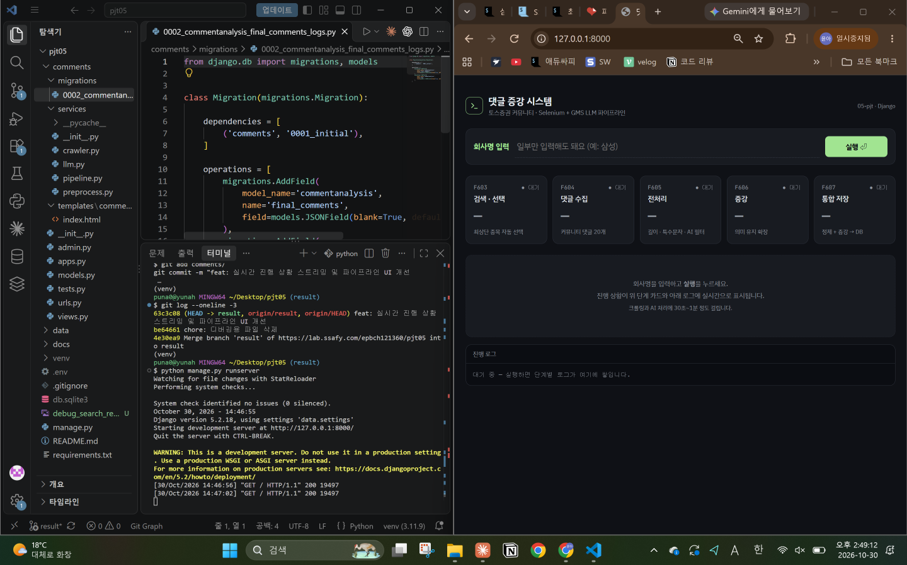

"삼성"을 입력하고 실행하면 VS Code 터미널에 입력한 회사명이 출력됩니다.

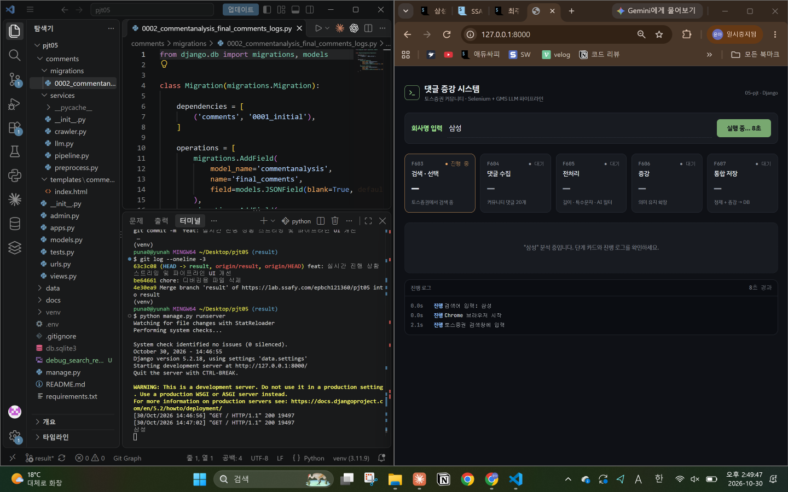

### F602 DB 스키마 및 저장 확인
`0002` 마이그레이션(통합 결과 · 진행 로그 칸 추가)이 적용된 모습입니다.

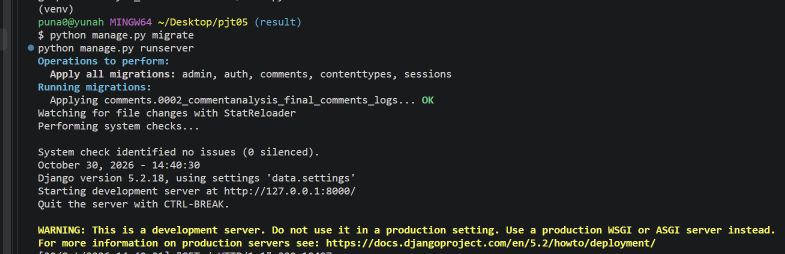

`CommentAnalysis` 모델과, 실제로 저장된 데이터(실제종목명 · 원본 · 정제 · 증강 · 통합 · IQR · 생성일시)를 조회한 결과입니다.

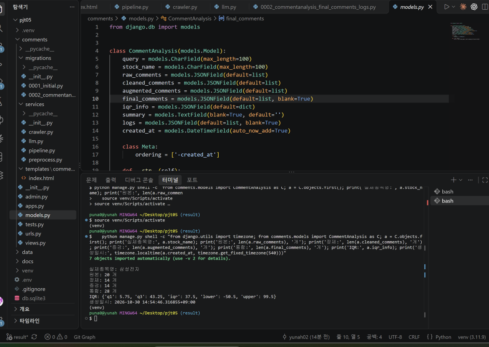

### F603 회사 검색 및 선택
"삼성"만 입력해도 검색 결과 최상단의 "삼성전자"가 자동으로 선택됩니다.

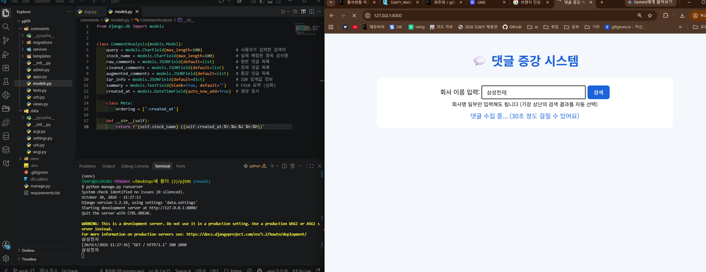

### F603 ⑧ 실시간 진행 상황 (스트리밍)
실행 중 화면입니다. 완료된 단계(F603~F605), 진행 중인 단계(F606, 주황 테두리), 대기 중인 단계(F607)가 실시간으로 표시되고, 진행 로그가 경과 시간과 함께 쌓입니다.

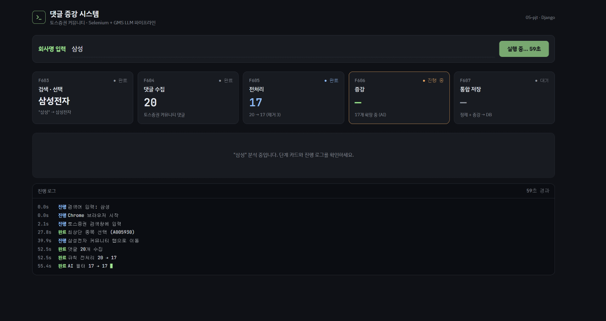

### F604 커뮤니티 댓글 수집
선택된 종목의 커뮤니티에서 댓글 20개를 수집했습니다.

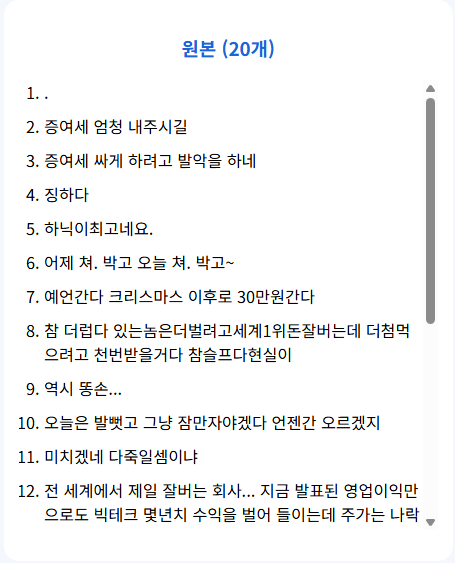

### F605 전처리
원본 댓글과 전처리 후 댓글을 비교한 화면입니다. 원본 칸의 `+`는 유지, `−`는 제거된 댓글입니다.

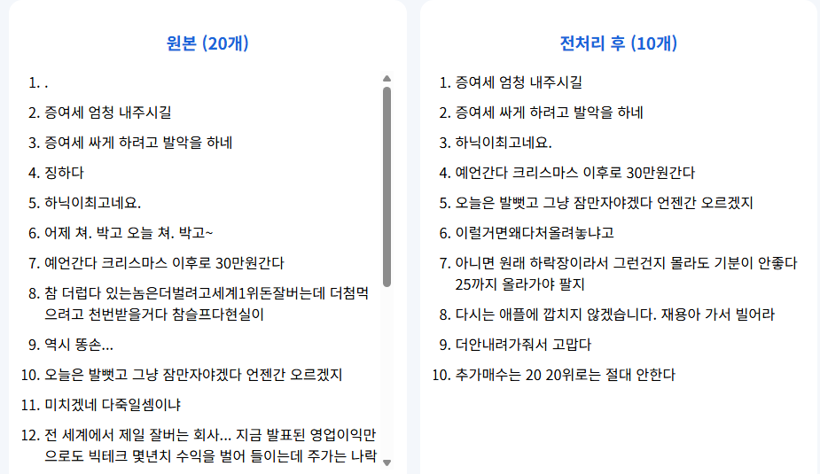

### F606 텍스트 증강
정제된 댓글을 의미를 유지한 채 확장한 결과입니다.
증강에 실패한 댓글은 결과에서 빠지므로, 원문과의 정확한 짝은 "최종 통합" 칸에서 번호로 확인할 수 있습니다.

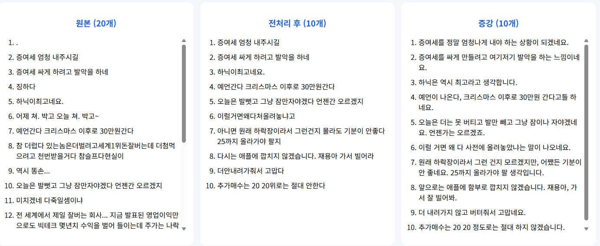

### F607 통합 결과
원본 / 정제 / 증강 / 최종 통합을 4칸으로 구분해 출력합니다. 최종 통합 칸은 정제 댓글 아래에 그 댓글의 증강 문장을 짝지어 보여 줍니다.

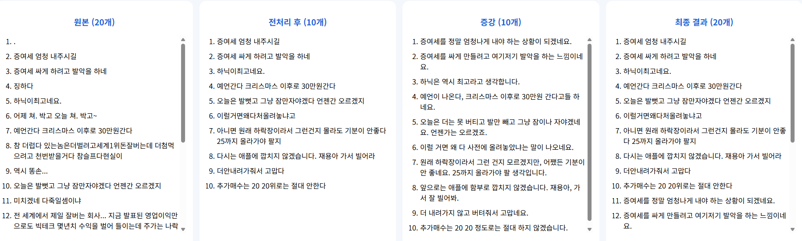

### F610 댓글 요약
"요약 생성" 버튼을 누르면 전체 원본 댓글의 요약이 출력됩니다.

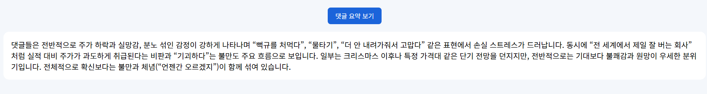

### F611 예외 상황 안내
존재하지 않는 회사명을 입력하면 오류 안내가 출력되고, 멈춘 단계(F603) 카드가 "실패"로 표시됩니다.

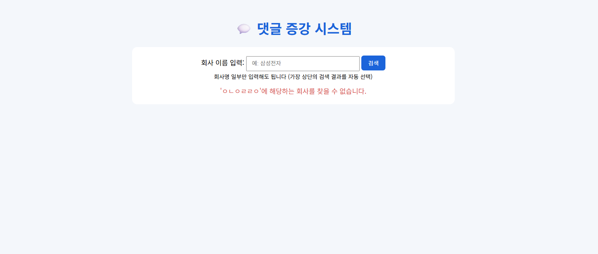

## 7. 학습 내용

- **Django 구조**: 프로젝트/앱 분리, URL → View → Template 흐름, 모델·마이그레이션(필드 추가 마이그레이션 포함), 쿼리스트링(GET) 입력 처리.
- **동적 페이지 크롤링**: 정적 요청으로는 가져올 수 없는 SPA 페이지를 Selenium으로 렌더링한 뒤 수집하는 방법. 명시적 대기(`WebDriverWait`)와 고정 대기(`sleep`)의 차이.
- **DevTools로 선택자 찾기**: 개발 중 페이지 스크린샷과 HTML을 저장해 DOM 구조를 직접 분석하고, 게시글 카드·본문 요소의 선택자를 확정했습니다.
- **텍스트 전처리**: 정규표현식으로 자모·특수문자·공백을 정리하고 길이 기준으로 필터링.
- **LLM 활용**: 프롬프트로 출력 형식(JSON)을 강제하고, 응답에 코드블록·설명이 섞여도 배열만 파싱하는 방어 로직, 번호 기반 매칭, 재시도 설계.
- **HTTP 스트리밍**: `StreamingHttpResponse`로 응답을 한 번에 보내지 않고 한 줄씩 나누어 보내는 방법. 오래 걸리는 작업을 스레드로 분리하고 큐로 진행 이벤트를 전달하는 생산자-소비자 구조.
- **프론트엔드에서 스트림 읽기**: `fetch` + `ReadableStream.getReader()` + `TextDecoder`로 도착하는 데이터를 줄 단위로 나눠 처리하고, DOM을 즉시 갱신하는 방법.
- **관심사 분리**: 크롤링 / 전처리 / LLM 호출 / 파이프라인 조율을 모듈로 나눠 view를 단순하게 유지.

## 8. 트러블슈팅

| 문제 | 원인 | 해결 |
|---|---|---|
| 검색 결과가 갱신되기 전의 항목이 클릭됨 | 모달 결과가 비동기로 바뀜 | 같은 결과가 연속 2번 감지될 때 클릭 |
| 종목명이 이전 값으로 읽힘 | 페이지 전환 직후 `title`이 아직 갱신되지 않음 | `title`에 `\|`가 나타날 때까지 대기 후 읽기 |
| 긴 댓글이 잘려서 수집됨 | 접힌(line-clamp) 글은 `.text`가 잘라서 반환 | `textContent` 속성으로 읽기 |
| 같은 글이 중복 수집됨 | 스크롤하며 DOM을 반복 조회 | `data-post-anchor-id`로 중복 제거 |
| LLM 응답 개수가 입력과 달라 매칭이 어긋남 | 모델이 일부 항목을 누락 | 번호(`i`)로 매칭하고 누락분만 재시도 |
| LLM 응답에 ```json 등이 섞임 | 모델의 서식 출력 | 정규식으로 `[ ... ]` 배열만 추출 |
| 처리 중 약 1분 동안 화면에 변화가 없음 | 모든 단계가 끝난 뒤 페이지를 한 번에 응답 | `StreamingHttpResponse`로 단계마다 진행 이벤트 전송 |
| Selenium 실행 중에는 진행 상황을 보낼 수 없음 | 크롤링 함수가 끝날 때까지 제어가 돌아오지 않음 | 파이프라인을 별도 스레드에서 실행하고, 콜백 → 큐 → 제너레이터로 이벤트 전달 |
| 증강이 일부 누락되면 최종 결과의 "원문-증강" 짝이 밀림 | 증강 결과를 순서만으로 이어 붙임 | `augment_indexed()`로 원본 번호를 유지해 `final_comments`에 짝지어 저장 |
| 결과 화면에서 다시 실행하면 이전 결과가 남아 보임 | 단계 카드 설명과 요약 카드를 초기화하지 않음 | 실행 시작 시 카드 설명을 대기 상태로 되돌리고 이전 요약 카드 제거 |

## 9. 한계 및 개선 방향

- 토스증권 화면 구조가 바뀌면 선택자(`crawler.py` 상단 상수)를 수정해야 합니다.
- 요청마다 Chrome을 새로 띄우고 LLM을 순차 호출해 전체 처리에 30초~1분이 걸립니다. 검색 단계는 토스증권 응답 속도에 따라 실행마다 시간이 크게 다릅니다.
- 진행 상황 스트리밍은 요청 하나당 스레드 하나를 사용합니다. 사용자가 많아지면 Celery 같은 비동기 작업 큐로 분리하는 것이 좋습니다.
- 저장된 분석 결과 목록(이력) 화면은 아직 없습니다. 결과는 `/comments/<pk>/` 주소로 개별 조회할 수 있습니다.
- LLM 기반 부적절 댓글 필터링은 실행할 때마다 결과가 조금씩 달라질 수 있습니다.

## 10. 느낀 점

### 피윤아: 크롤링 및 데이터 파이프라인 / LLM 연동 담당
- **동적 타이밍 제어와 방어적 크롤링**: 토스증권처럼 비동기로 데이터를 불러오는 SPA 환경에서 Selenium을 다룰 때, 단순 대기(`sleep`)보다는 DOM의 변화 상태를 직접 감지하는 방어적 코드가 얼마나 중요한지 체감했습니다. 안정적인 자동화 파이프라인을 구축하는 뼈대를 배웠습니다.
- **LLM 데이터 파이프라인 통제**: LLM은 만능이 아니라 철저한 '입출력 통제'가 필요하다는 점을 깨달았습니다. 응답에 마크다운(` ```json `)이 섞이거나 일부 항목이 누락되는 예외 상황에 대비해, 정규식 파싱과 번호(`i`) 기반 매칭, 그리고 재시도 로직을 직접 구현하면서 견고한 에러 핸들링 능력을 기를 수 있었습니다.
이후 프론트엔드 만들고 다듬기, 심화 기능 발전까지 수행해 전반적인 프로젝트의 흐름을 이해 및 구현할 수 있었습니다.

### 최주희: Django 백엔드 설계 및 UI/UX / 예외 처리 담당
- **관심사 분리와 모듈화의 가치**: 크롤링, 전처리, LLM 서비스 로직을 `services/` 패키지로 명확히 분리해 둔 덕분에, 비즈니스 로직 수정이나 디버깅을 할 때 뷰(View)를 건드리지 않고 모듈 단위로 독립적인 테스트와 검증을 할 수 있어 유지보수성이 크게 좋아짐을 느꼈습니다.
- **사용자 경험(UX) 중심의 예외 처리**: 검색 결과가 없거나 크롤링 도중 오류가 발생했을 때 사용자가 당황하지 않도록 적절한 안내 메시지를 출력하고, 비동기(Fetch) 기반의 댓글 요약 기능을 구현하면서 프론트엔드와 백엔드 간의 매끄러운 비동기 통신 흐름을 깊이 있게 이해하며 프로젝트에 대한 이해도가 높아지게 되었습니다.
